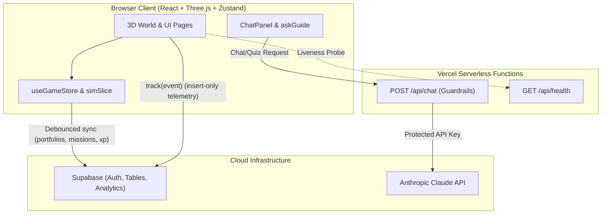

# MONEYVERSE

**Understand Money. Explore Markets. Build Your Future.**

[](LICENSE)
[](.github/workflows/ci.yml)

---

## What is MONEYVERSE?

MONEYVERSE is an interactive 3D financial education application designed to demystify investing for beginners. Players traverse a virtual market world, experiment with risk-free paper trading, and observe how market shock scenarios affect diversified versus concentrated portfolios. An embedded AI Guide provides plain-English explanations, interactive quizzes, and contextual feedback on every decision.

> [!IMPORTANT]
> **Educational & Simulated Data Notice**
> All companies, stock symbols, ticker prices, scenarios, and trades in MONEYVERSE are completely fictional and simulated. No real money or brokerage transactions are involved. MONEYVERSE provides educational simulations only and does not offer financial or investment advice.

---

## Features (MVP)

- **Cinematic 3D Entry**: Immersive forward-flying camera journey along a central river navigating financial districts with custom shaders and postprocessing (`src/scene`).
- **Stock Market City**: Visual district where tradable companies reflect distinct industry sectors (`src/world`).
- **Paper Trading Engine**: Pure TypeScript simulation supporting deterministic price movements, market valuation, and instant buy/sell orders (`src/sim`).
- **Crash Simulator**: Interactive market shock scenarios (e.g. 20% market drop, tech selloff) showing sector beta impact on portfolio holdings (`src/sim/scenarios.ts`).
- **AI Financial Guide**: Server-side LLM proxy with guardrails preventing financial advice and breaking down portfolio shifts into plain English (`api/chat.ts`, `src/ai`).
- **Quizzes & Gamified XP**: Topic-based financial literacy quizzes awarding virtual XP to build learner confidence (`src/ai/quiz`, `src/learning`).

---

## Architecture

MONEYVERSE organizes functionality into four decoupled engines mapped to project directories:

```text
[ Game & World Engine ]     --> src/scene, src/world (Three.js, R3F, camera paths)
[ Learning Engine ]          --> src/learning, src/ai/quiz (Quizzes, missions, XP)
[ Simulation Engine ]        --> src/sim, src/portfolio (Pricing, trading math, wallet)
[ AI Assistant Engine ]      --> api/chat.ts, src/ai (Prompt guardrails, context builder)
```

### Data Flow Diagram



---

## Tech Stack

| Layer | Technology | Purpose |
| --- | --- | --- |
| **Frontend Framework** | React 18 + Vite + TypeScript | High-performance SPA with strict typing |
| **Styling & Design** | Tailwind CSS + Oswald / Inter fonts | Modern dark-mode neon financial aesthetic |
| **3D Rendering** | Three.js + React Three Fiber + Drei | Cinematic intro world, river spline, custom post-effects |
| **Client State** | Zustand + LocalStorage persist | Fast state slices for sim, game progress, and guest mode |
| **Backend / API** | Vercel Serverless Functions (@vercel/node) | Protected LLM proxy and liveness health checks |
| **Database & Auth** | Supabase (PostgreSQL + RLS) | User accounts, progress persistence, and analytics telemetry |
| **Testing & Tooling** | Vitest + ESLint + TypeScript Compiler | Unit test suite and static type validation |

---

## Getting Started

### Prerequisites

- Node.js (v20+ recommended)
- npm (v10+)
- (Optional) [Vercel CLI](https://vercel.com/docs/cli) for running `/api` serverless functions locally

### Installation

1. **Clone the repository**:
   ```bash
   git clone https://github.com/moneyverse/moneyverse.git
   cd moneyverse
   ```

2. **Install dependencies**:
   ```bash
   npm install
   ```

3. **Configure environment variables**:
   ```bash
   cp .env.example .env.local
   ```
   *(Edit `.env.local` with your Supabase credentials and Anthropic API key).*

4. **Initialize Supabase database**:
   Run the SQL setup files in the Supabase SQL Editor in the following order:
   - `supabase/schema.sql`: Core tables (`profiles`, `portfolios`, `mission_progress`), RLS policies, and triggers.
   - `supabase/analytics.sql`: Event analytics table (`public.events`) with insert-only permissions.

5. **Start development server**:
   ```bash
   npm run dev
   ```
   *Visit `http://localhost:5173` in your browser.*

6. **Run with backend API (optional)**:
   ```bash
   vercel dev
   ```
   *Runs frontend and `/api` serverless proxy simultaneously at `http://localhost:3000`.*

---

## Environment Variables

| Variable | Scope | Required? | Exposed to Client? | Description |
| --- | --- | --- | --- | --- |
| `VITE_SUPABASE_URL` | Client | Yes | Yes (Public) | Supabase project URL |
| `VITE_SUPABASE_ANON_KEY` | Client | Yes | Yes (Public) | Supabase anonymous public key (protected by RLS) |
| `ANTHROPIC_API_KEY` | Server | Yes (for AI) | **No (Never)** | Anthropic Claude API key for `/api/chat` |
| `LLM_MODEL` | Server | No | **No (Never)** | Model override (defaults to `claude-haiku-5-5`) |
| `SUPABASE_SERVICE_ROLE_KEY` | Scripts | No (Demo/Admin) | **No (Never)** | Supabase service role key used only for `seed:demo` |
| `DEMO_PASSWORD` | Scripts | No (Demo) | **No (Never)** | Custom password for `demo@moneyverse.dev` seeding |

---

## Demo Tips

- **Instant Zero-Network Demo**: Append `?demo=1` to any URL (e.g. `http://localhost:5173/?demo=1`). This flags demo mode in `localStorage`, preloads a sample portfolio, stocks, missions, and XP, and bypasses all remote Supabase table calls.
- **Demo Account Seeding**: Run `npm run seed:demo` to create or update `demo@moneyverse.dev` with a known password, 4,000 virtual cash, 3 holdings across 2 sectors, and 2 completed missions.
- **Environment Verification**: Run `npm run check:env` to audit local `.env.local` configuration without printing values.
- **Full Verification Pass**: Run `npm run verify` to execute a type check, production build, bundle secret scan, and test suite.

---

## Available Scripts

| Command | Description |
| --- | --- |
| `npm run dev` | Launch Vite local dev server (`localhost:5173`) |
| `npm run build` | Compile TypeScript and bundle production assets to `dist/` |
| `npm run preview` | Locally preview production build |
| `npm run lint` | Run ESLint across `src/` and `api/` |
| `npm test` | Run all unit tests via Vitest |
| `npm run test:watch` | Run Vitest in interactive watch mode |
| `npm run test:ui` | Run Vitest with graphical web UI |
| `npm run check:env` | Validate presence of required and optional environment variables |
| `npm run seed:demo` | Seed `demo@moneyverse.dev` in Supabase using the service role |
| `npm run scan:bundle` | Scan `dist/` output for leaked keys, secrets, and patterns |
| `npm run verify` | Full CI verification pass: `build` + `scan:bundle` + `test` |

---

## Testing

Unit tests are written with [Vitest](https://vitest.dev) and cover the pricing engine, trading math, portfolio valuations, RNG determinism, AI scenario fact generation, quiz bank parsing, demo mode state, and serverless proxy guardrails.

```bash
npm test
```

---

## Deployment on Vercel

MONEYVERSE is built for frictionless deployment on Vercel:

1. Push your branch to GitHub.
2. Import the project in the Vercel dashboard.
3. Configure project environment variables (`VITE_SUPABASE_URL`, `VITE_SUPABASE_ANON_KEY`, `ANTHROPIC_API_KEY`).
4. Vercel automatically deploys the frontend and mounts serverless routes in `/api`.
5. SPA route rewrites are configured in `vercel.json` (`/((?!api/).*)` -> `/index.html`).

---

## Project Structure

```text
MONEYVERSE/
├── api/                    # Vercel serverless functions
│   ├── chat.ts             # AI Guide proxy with guardrails & rate limiting
│   └── health.ts           # Health & configuration probe
├── docs/                   # Developer documentation
│   ├── ADDING_A_DISTRICT.md# Guide for extending the 3D map
│   ├── ADDING_A_MISSION.md # Guide for creating missions
│   └── GOOD_FIRST_ISSUES.md# 8 starter tasks for contributors
├── public/                 # Static public assets
├── scripts/                # Developer & demo safety tooling
│   ├── checkEnv.ts         # Validate environment variables
│   ├── scanBundle.ts       # Scan dist/ for leaked secrets
│   └── seedDemo.ts         # Idempotent demo account seeder
├── src/                    # Frontend source code
│   ├── ai/                 # AI assistant UI, quiz cards, scenario explainer
│   ├── auth/               # User badge & authentication modal
│   ├── components/shared/  # SimulatedBadge, ErrorBoundary
│   ├── learning/           # Missions and educational progress
│   ├── lib/                # Auth hooks, Supabase client, track, global errors
│   ├── portfolio/          # Portfolio dashboard and holdings breakdown
│   ├── scene/              # Three.js 3D world, spline river, camera controls
│   ├── sim/                # Deterministic simulation, trading engine, companies
│   ├── store/              # Zustand stores (useGameStore, simSlice)
│   ├── types.ts            # Core TypeScript shared contracts
│   ├── App.tsx             # Application routing & top-level error containment
│   └── main.tsx            # Entry point initializing error handlers & sync
├── supabase/               # PostgreSQL schemas & reporting queries
│   ├── analytics.sql       # Telemetry events table & policies
│   ├── metrics.sql         # SQL Editor reporting queries
│   └── schema.sql          # Core tables, RLS policies, and user triggers
└── vercel.json             # Vercel routing and SPA rewrites
```

---

## Roadmap

- [x] Phase 1: Core simulation engine, paper trading, and deterministic price paths
- [x] Phase 2: Cinematic 3D intro river and Stock Market City district
- [x] Phase 3: AI Financial Guide with guardrails and interactive quiz mode
- [x] Phase 4: Supabase authentication, cloud sync, and product analytics
- [ ] Phase 5: Investment Forest (mutual funds & ETFs district)
- [ ] Phase 6: IPO Island (primary offerings and valuation mechanics)
- [ ] Phase 7: RAG knowledge base for expanded financial curriculum
- [ ] Phase 8: Multi-language localization and translation

---

## Contributing

We welcome community contributions! Please review [CONTRIBUTING.md](CONTRIBUTING.md) and our [CODE_OF_CONDUCT.md](CODE_OF_CONDUCT.md) before submitting a pull request. Check out [docs/GOOD_FIRST_ISSUES.md](docs/GOOD_FIRST_ISSUES.md) for beginner-friendly tasks.

---

## License

This project is licensed under the MIT License - see the [LICENSE](LICENSE) file for details.
